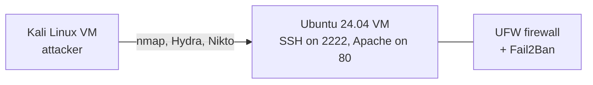
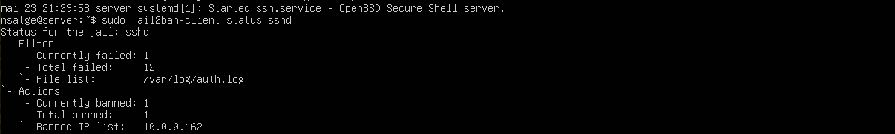
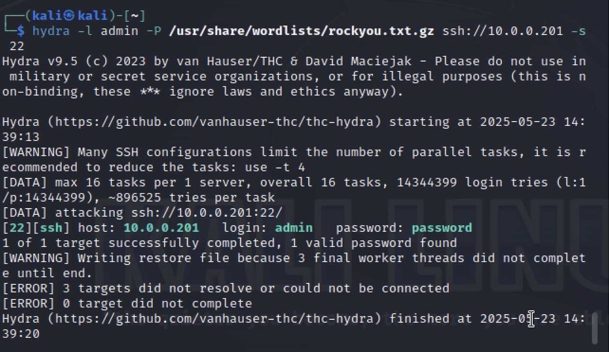
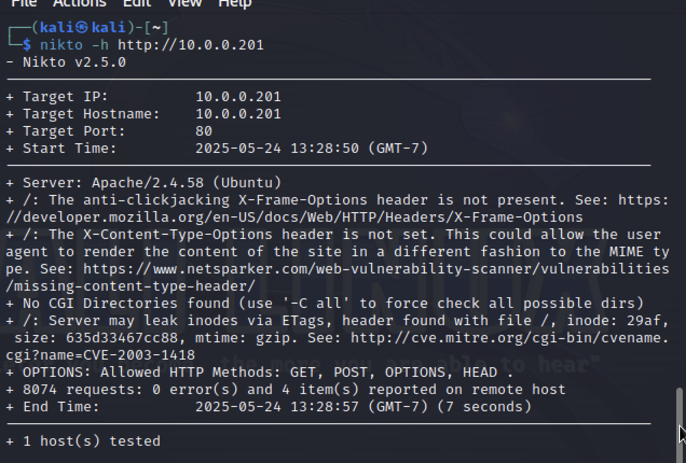
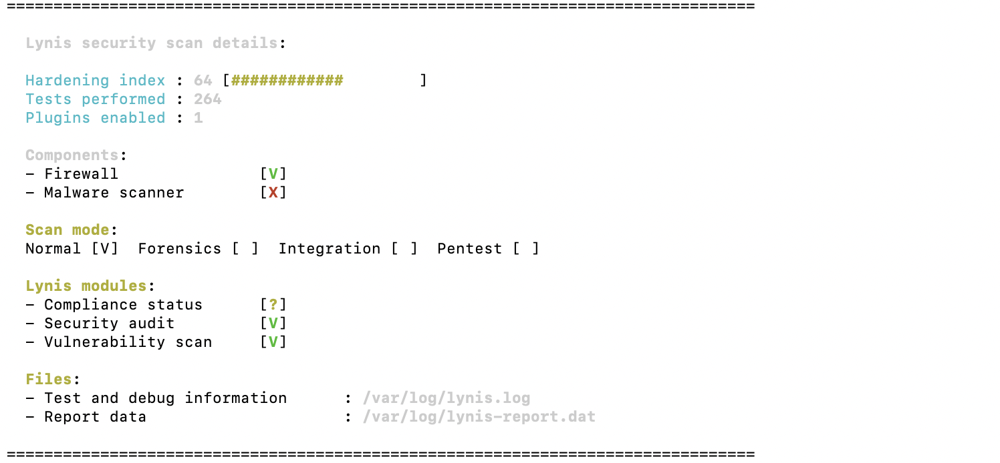

# Linux Server Hardening + Attack Tests from Kali

I built a small Ubuntu server, hardened it, and attacked it from a Kali Linux VM to test the defenses.
Goal: practice hardening, monitoring, and a defensive mindset against common attacks.

**Stack:** Ubuntu Server 24.04 · OpenSSH · UFW · Fail2Ban · Apache · Lynis · Kali Linux (nmap, Hydra, Nikto)

## Lab setup



- Two VMs in UTM on the same bridged (or internal) network, so Kali can reach the server.
- Packages on the server:

```bash
sudo apt update && sudo apt upgrade
sudo apt install apache2 openssh-server ufw fail2ban lynis net-tools
```

| Tool | Why |
|---|---|
| Apache | An exposed web service (port 80) to scan |
| OpenSSH | Remote access, so a target to secure |
| UFW | Simple host firewall |
| Fail2Ban | Bans IPs after failed logins (brute-force protection) |
| Lynis | Security audit of the system |

## Hardening

### 1. SSH keys (do this first, while password login still works)

From Kali:

```bash
ssh-keygen -t ed25519
ssh-copy-id <your_user>@<server_ip>
```

### 2. SSH config and firewall

`/etc/ssh/sshd_config`:

```bash
Port 2222
PermitRootLogin no
PasswordAuthentication no
AllowUsers <your_user>
```

Open the new port **before** you restart SSH, or you lock yourself out. Then open only what the server needs:

```bash
sudo ufw default deny incoming
sudo ufw allow 2222/tcp
sudo ufw allow 80/tcp
sudo ufw enable

# Ubuntu 24.04 starts SSH through a systemd socket, so reload it to apply the new port
sudo systemctl daemon-reload
sudo systemctl restart ssh.socket
```

Test from Kali: `ssh -p 2222 <your_user>@<server_ip>`

### 3. Fail2Ban

```bash
sudo cp /etc/fail2ban/jail.conf /etc/fail2ban/jail.local
sudo systemctl enable --now fail2ban
```

`[sshd]` section in `/etc/fail2ban/jail.local` (full file in [`fail2ban/jail.local`](fail2ban/jail.local)):

```ini
[sshd]
enabled  = true
port     = 2222
maxretry = 3
bantime  = 3600
```

Check it: `sudo fail2ban-client status sshd`

### 4. Audit with Lynis

```bash
sudo lynis audit system
```

## Attacks from Kali

```bash
# 1. Reconnaissance: all ports and service versions
nmap -p- -sV <server_ip>

# 2. SSH brute force on port 2222
hydra -l admin -P /usr/share/wordlists/rockyou.txt.gz ssh://<server_ip> -s 2222

# 3. Web vulnerability scan
nikto -h http://<server_ip>
```

## Results

All numbers come from the logs and the report in this repository (May 2025).

| Test | Result | Evidence |
|---|---|---|
| Lynis audit | Hardening index **65 / 100**, 1 warning (no security repository in APT sources), 47 suggestions | [`lynis/lynis-report.dat`](lynis/lynis-report.dat) |
| Hydra brute force | 18 failed password attempts, then Fail2Ban **banned the Kali IP** on 23 May 2025 at 21:39 | [`ssh/auth.log`](ssh/auth.log), [`fail2ban/fail2ban.log`](fail2ban/fail2ban.log) |
| Nikto scan | Scan requests visible in the Apache access log | [`apache/access.log`](apache/access.log) |






## What I learned from reviewing my own config

A later review found two typos in the first `jail.local`: `enable = true` instead of `enabled`, and
`mexretry = 3` instead of `maxretry`. Fail2Ban ignores unknown keys without an error. The ban still worked
only because Ubuntu enables the `sshd` jail by default, and `fail2ban.log` shows `maxRetry: 5`, not 3.
The config in this repository is now fixed. Lesson: always check the running config
(`fail2ban-client get sshd maxretry`), not only the file.

The same review found that the first version of this guide opened port 22 in UFW while SSH ran on 2222.
The firewall steps above are corrected.

## Next steps

- [ ] HTTPS with a reverse proxy (Nginx + Let's Encrypt)
- [ ] Automate the whole setup with Ansible
- [ ] Send logs to a SIEM (Wazuh or Elastic) and write detection rules
- [ ] Fix the Lynis warning and the top suggestions, then compare the new score
